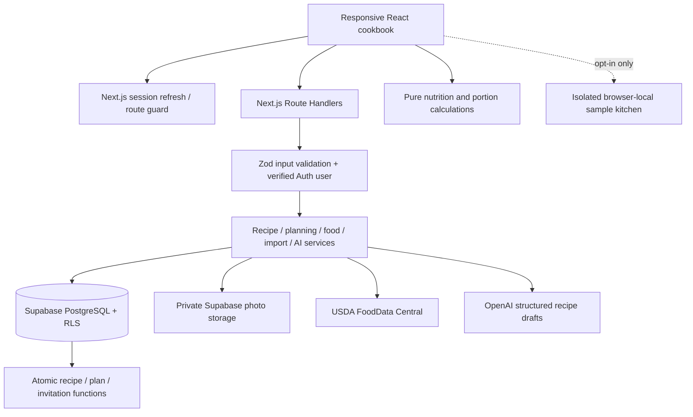

# Architecture

## Boundaries

Server layout supplies only configuration flags to the client. Protected application screens are interactive client components within a server-rendered App Router shell. `proxy.ts` refreshes cookie sessions and redirects unauthenticated UI access. Every API request independently verifies the user with Supabase `getUser`; proxy checks are not the authorization boundary. Requests mutate through the caller's JWT, not a service key. Zod validates payloads before services use them. Mutation requests must come from the same origin.

`repository.ts` maps relational rows into typed UI models. Nutrition and planning are pure modules independent of React, API credentials, and database SDKs. The demo adapter stores only its own sample dataset under a dedicated browser key and never contacts cloud endpoints for fake writes. Cloud data is refreshed after writes and when explicitly reloaded. Initial scope favors a single household collection load and client-side search for two users; larger datasets should move search/filter pagination into server queries.

## Relational model

Profiles reference Auth users. Household memberships connect people to households. Recipes own ordered ingredients, ordered instructions, photos and tag assignments. Food items and nutrient records separate food identity from recipe quantity. Foods are household-scoped, including USDA records, so household custom labels stay private. Child records carry `household_id` with composite foreign keys to prevent cross-household recipe, food, tag and member references. Meal entries reference a recipe and a plan; portion rows reference household members. Notes, ratings and favourites are user-scoped.

RLS is enabled for every application table. Security-definer membership helpers avoid recursive membership policies and use an empty search path. Create/join functions alone can modify membership; clients have no insert policy on that table. Invitations and usage counters are not readable directly. Invoker recipe/food/plan functions retain RLS and transactionally replace related rows. Security-definer invitation functions verify the caller, target verified email, expiration, use state and household capacity while locking rows. Execute privileges are explicitly limited to authenticated users.

## Nutrition

An ingredient has quantity/unit, an optional **total gram equivalent for that ingredient quantity**, and an optional canonical food record. Grams and kilograms convert directly. Other units require that food's documented grams-per-unit or the explicit gram equivalent. Changing quantity clears a manual equivalent in the editor, so it must be reviewed again. Scaling the completed recipe scales both quantities and equivalents proportionally.

Each known nutrient contributes `(grams / 100) × source value`. A missing food, conversion, or nutrient produces `null`. If any non-zero ingredient is unknown for a nutrient, that entire recipe nutrient stays unknown rather than displaying a partial sum as a total. Empty recipes are unknown. Zero quantity contributes zero. Recipe totals divide by a positive serving count. UI rounding happens only at display; calculations retain numeric precision. Source-provided kcal are used without reverse-calculating energy from macros. Raw/cooked state is shown for user review; cooking water changes are not inferred.

Plan portions sum independently per person and date. Batch quantities scale each recipe by `required portions / original servings`. Aggregation merges only the same known food, unit, and conversion basis. Unmatched foods and different raw/cooked records remain separate. Calendar arithmetic uses UTC calendar dates to avoid DST drift. Refrigeration warnings count prep day as day one. Freezing excludes a portion from fridge-day comparison but does not certify freezing safety.

## External boundaries

USDA IDs are fetched again server-side before persistence. Missing nutrients remain unknown; the AI cannot attach food records. The Responses API requests a Zod-derived strict structured output, has a 30-second timeout, no automatic retries, bounded tokens, no response storage, and 10 requests per user per hour. Import and food lookup quotas are 20 and 120 per hour, enforced atomically in PostgreSQL across server instances.

Importer requests accept only public HTTP(S) endpoints on default ports without embedded credentials. DNS resolution is checked in the connection lookup so actual socket addresses are pinned and private/reserved addresses are rejected. Redirects are explicit and revalidated. Response size, redirects and request duration are bounded. JSON-LD traversal extracts essential fields; incomplete recipes fail. Imported images are not copied. HTML text is stripped and rendered through React escaping, never injected as source HTML.

Uploads require JPEG/PNG/WebP input, a size bound, and successful Sharp decoding with a pixel limit. They are rotated, resized and re-encoded to WebP, removing metadata. Storage is private under the household UUID prefix. Display uses short-lived signed URLs. Uploads created and then abandoned can leave orphaned storage objects; a scheduled cleanup job is future work. No background scheduler is configured.

## Deliberate limits

There is no live conflict resolution or realtime subscription. Last successful recipe save wins. No audit history or soft-delete recovery is implemented. Photo signed URLs expire after an hour and refresh with household data. Invitations are copied manually rather than emailed. An account currently joins one household; the schema supports many separate households. Moving to multiple memberships per account requires relaxing the user membership uniqueness constraint and adding a household picker, rather than redesigning recipe ownership.
